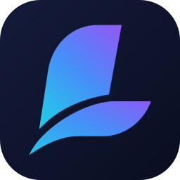
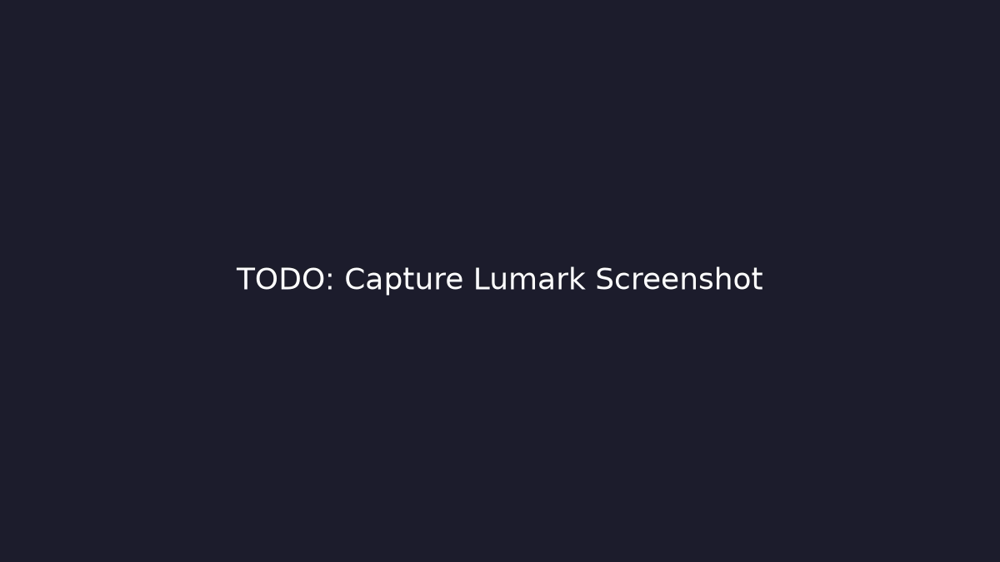

<p align="center">
  
</p>

# Lumark

Fast, cross-platform desktop Markdown reader.

[](https://github.com/yahya-mehrabani/Lumark/releases/latest)
[](LICENSE)
[](https://github.com/yahya-mehrabani/Lumark/actions/workflows/linux-build.yml)
[](https://github.com/yahya-mehrabani/Lumark/actions/workflows/macos-build.yml)
[](https://github.com/yahya-mehrabani/Lumark/actions/workflows/windows-build.yml)
[](#download)
[](https://go.dev)

<!-- TODO: Capture production screenshot (Light/Dark mode, mixed Persian RTL, KaTeX math, and Mermaid diagram) -->


Lumark is a dedicated desktop reader built for viewing Markdown files as clean, richly formatted documents—completely offline, secure by default, and integrated with your operating system.

## Features

- **Rich Document Rendering:** CommonMark, GitHub Flavored Markdown (tables, task lists, strikethrough, autolinks), LaTeX math via KaTeX, syntax-highlighted code blocks via Shiki, and diagrams via Mermaid.
- **First-Class Bidirectional Support:** Automatic per-block text direction detection (`dir="auto"`) for Persian, Arabic, and Hebrew. Inline and block code, math formulas, and diagrams remain strictly left-to-right.
- **Offline & Zero Telemetry:** Local-first rendering with zero remote network requests, no analytics, and strict HTML/CSS sanitization.
- **Desktop Integration:** File associations for `.md` and `.markdown`, command-line opening (`lumark file.md`), single-instance window routing, and multi-document tabs.
- **Reading Tools:** Interactive Table of Contents sidebar, in-document search with match cycling, zoom controls (50%–300%), and print styling.

> **RTL Example / نمونه راست‌به‌چپ:**
> لومارک به طور خودکار جهت پاراگراف‌های فارسی و عربی را تشخیص می‌دهد، در حالی که کدهای درون‌خطی مانند `const x = 42;` و روابط ریاضی مانند $\int_0^\infty e^{-x} dx = 1$ به صورت چپ‌به‌راست نمایش داده می‌شوند.

## Download

Grab the latest installer or portable package from the [Releases page](https://github.com/yahya-mehrabani/Lumark/releases/latest):

| Platform | Architecture | File Pattern | Notes |
|---|---|---|---|
| **Windows** | x64 (AMD64) | `lumark_*_windows_amd64_setup.exe` | NSIS installer |
| **macOS** | Universal (Apple Silicon & Intel) | `lumark_*_macos_universal.dmg` | Disk image installer |
| **macOS** | Universal (Apple Silicon & Intel) | `lumark_*_macos_universal.zip` | Portable application archive |
| **Linux** | x64 (AMD64) | `lumark_*_linux_amd64.deb` | Debian / Ubuntu package |
| **Linux** | x64 (AMD64) | `lumark_*_linux_amd64.AppImage` | Standalone portable executable |
| **Linux** | x64 (AMD64) | `lumark_*_linux_amd64.rpm` | Fedora / RHEL package |
| **Linux** | x64 (AMD64) | `lumark_*_linux_amd64.tar.gz` | Portable standalone binary archive |

## Installation

### Windows
1. Download `lumark_*_windows_amd64_setup.exe` from [Releases](https://github.com/yahya-mehrabani/Lumark/releases/latest).
2. Run the installer and follow the setup wizard.
3. **Unsigned Build Notice:** Release builds are currently unsigned. If Windows SmartScreen displays *"Windows protected your PC"*, click **More info**, then select **Run anyway**.

### macOS
1. Download `lumark_*_macos_universal.dmg` from [Releases](https://github.com/yahya-mehrabani/Lumark/releases/latest).
2. Open the `.dmg` file and drag `Lumark.app` to your `/Applications` folder.
3. **Unsigned Build Notice:** Release builds are currently unsigned without an Apple Developer ID. If macOS Gatekeeper blocks opening:
   - In Finder, open `/Applications`, **right-click** `Lumark.app`, select **Open**, and click **Open** in the confirmation dialog; or
   - Run in Terminal: `xattr -dr com.apple.quarantine /Applications/Lumark.app`

### Linux
- **Debian / Ubuntu:**
  ```bash
  sudo apt install ./lumark_*_linux_amd64.deb
  ```
- **AppImage (Standalone):**
  ```bash
  chmod +x lumark_*_linux_amd64.AppImage
  ./lumark_*_linux_amd64.AppImage
  ```
  *(Note: Ubuntu 24.04+ requires `libfuse2t64` to launch AppImages: `sudo apt install libfuse2t64`)*
- **Fedora / RHEL:**
  ```bash
  sudo dnf install ./lumark_*_linux_amd64.rpm
  ```

### Verifying Downloads

Release assets are published with `SHA256SUMS.txt`. Verify your download integrity:

- **Linux:**
  ```bash
  sha256sum -c SHA256SUMS.txt --ignore-missing
  ```
- **macOS:**
  ```bash
  shasum -a 256 <filename>
  ```
- **Windows (PowerShell):**
  ```powershell
  Get-FileHash .\<filename> -Algorithm SHA256
  ```

## Usage

- **Open Files:** Double-click associated `.md` files, drag and drop files onto the window, or click **Open File**.
- **CLI Commands:**
  ```bash
  lumark document.md
  lumark docs/intro.md docs/spec.md
  ```
  *(If Lumark is already running, documents open as new tabs in the existing window)*.
- **Keyboard Shortcuts:**
  - `Ctrl+F` / `Cmd+F`: Find text in document (`Enter`/`F3` next, `Shift+Enter`/`Shift+F3` previous, `Esc` close)
  - `Ctrl+L` / `Cmd+L` or `Alt+T`: Toggle Table of Contents outline sidebar
  - `Ctrl+=` / `Ctrl+-` / `Ctrl+0`: Zoom in, zoom out, or reset zoom to 100%
  - `Ctrl+W` / `Cmd+W`: Close active tab
  - `Ctrl+P` / `Cmd+P`: Print document
  - `Esc`: Close modals and search bar

## Privacy & Security

Lumark is built on a local-first threat model. Rendering occurs 100% offline with zero external network requests, zero telemetry, and zero crash reporting. All HTML/CSS and SVG content passes through strict sanitization filters (`rehype-sanitize`) to prevent script execution, CSS escape attacks, and protocol exploitation.

Read our complete [Security Specification](docs/security.md) and [Security Policy](SECURITY.md).

## Building from Source

### Prerequisites

- **Go:** `1.26.0+` (toolchain `1.26.10`)
- **Node.js & npm:** `Node.js v22.x LTS`
- **Wails v3 CLI:** `go install github.com/wailsapp/wails/v3/cmd/wails3@v3.0.0-beta.34`
- **Task (go-task):** `v3.x` ([installation guide](https://taskfile.dev/installation/))
- **Platform Dependencies:**
  - *Linux (Ubuntu/Debian):* `sudo apt-get install -y libgtk-4-dev libwebkitgtk-6.0-dev libgtk-3-dev libwebkit2gtk-4.1-dev build-essential pkg-config desktop-file-utils`
  - *macOS:* Xcode Command Line Tools, `brew install create-dmg`
  - *Windows:* C++ build tools (Visual Studio or MinGW), NSIS

### Development & Build Commands

```bash
# 1. Install frontend dependencies
cd frontend && npm ci && cd ..

# 2. Run local development server
npm run dev

# 3. Run test suites
npm test                # Frontend unit & component tests
go test ./...           # Go backend unit tests
npm run test:security   # Adversarial security test corpus
npm run test:fixtures   # Golden markdown fixture suite
npm run test:offline    # Offline network isolation verification
npm run benchmark       # Rendering latency & memory benchmarks

# 4. Build production packages
# Linux:
npm run build:deb       # Debian package (.deb)
npm run build:appimage  # Standalone AppImage
# macOS:
task darwin:package APP_NAME=Lumark
# Windows:
wails3 build
```

## Documentation

- [Security & Privacy Specification](docs/security.md)
- [Markdown Compatibility Contract](docs/markdown-support.md)
- [Platform Support Matrix](docs/architecture/PLATFORM-SUPPORT.md)
- [Packaging & OS Integration](docs/packaging.md)
- [Release Acceptance Checklist](docs/release-checklist.md)
- [Architecture Overview](docs/architecture/OVERVIEW.md)
- [Product Requirements Document (PRD)](docs/PRD.md)

## Contributing

Contributions, bug reports, and suggestions are welcome! Please read [CONTRIBUTING.md](CONTRIBUTING.md) and our [Code of Conduct](CODE_OF_CONDUCT.md).

## Security

To report a security vulnerability, please submit a private advisory through [GitHub Security](https://github.com/yahya-mehrabani/Lumark/security/advisories/new). See [SECURITY.md](SECURITY.md) for full disclosure policies and response timelines.

## License

This project is licensed under the [MIT License](LICENSE) © 2026 Yahya Mehrabani.

## Acknowledgments

Lumark is powered by open-source technologies:
- [Wails](https://wails.io/) — Cross-platform Go desktop application framework
- [React](https://react.dev/) & [Vite](https://vitejs.dev/) — Frontend interface and asset bundler
- [KaTeX](https://katex.org/) — Fast math formula typesetting
- [Mermaid](https://mermaid.js.org/) — Diagram and chart generation
- [Shiki](https://shiki.style/) — Syntax highlighter
